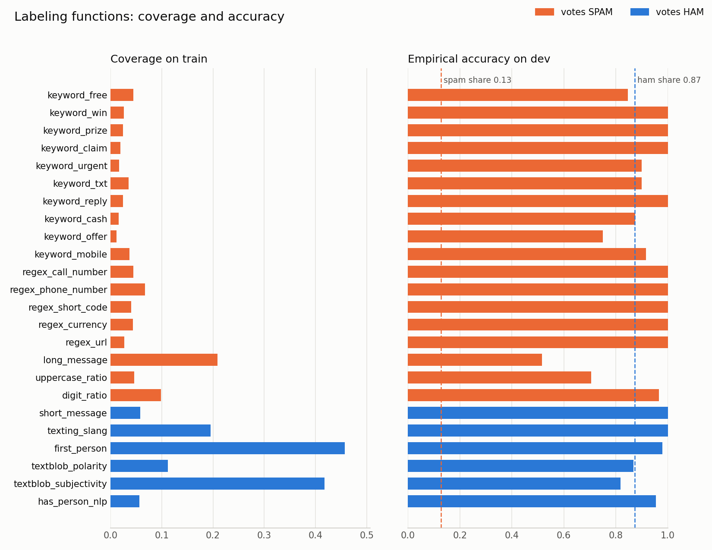
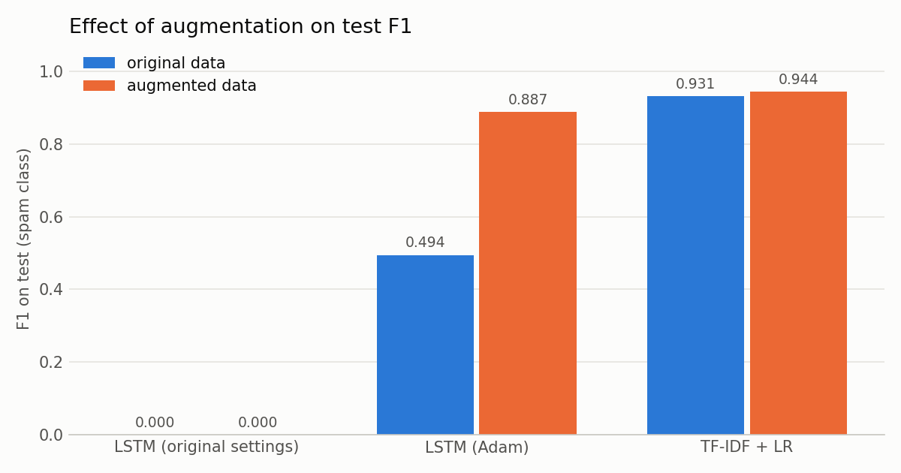
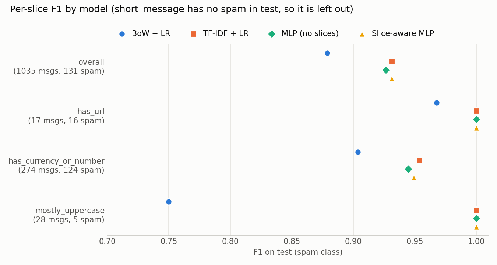

# Data Labeling Lab: Weak Supervision for SMS Spam with Snorkel


Most of the work in a supervised ML project is getting labels. Weak supervision replaces hand labeling with code: I write small, noisy rules called labeling functions (LFs) that vote "spam", "ham" or abstain, and Snorkel's `LabelModel` learns how much to trust each rule from how they agree and disagree. The result is a probabilistic label for every message, which I then use to train a normal classifier.

This lab redoes the three Snorkel spam notebooks from the course repo ([Labs/Data_Labs/Data_Labeling_Labs](https://github.com/Het415/MLOps/tree/main/Labs/Data_Labs/Data_Labeling_Labs)) on a different dataset, SMS messages instead of YouTube comments:

1. `01_sms_spam_labeling_functions.ipynb`: write and analyze 24 LFs, combine them with majority vote and the `LabelModel`, train end models on the weak labels
2. `02_sms_spam_data_augmentation.ipynb`: grow the training set with transformation functions and check whether it helps
3. `03_sms_spam_data_slicing.ipynb`: track performance on important slices of the data and train a slice-aware model

## What I changed from the original lab

| | Original | This version |
|---|---|---|
| **Dataset** | YouTube Spam Collection: 1,956 comments from 5 videos (Psy, Katy Perry, LMFAO, Eminem, Shakira), 51% spam | UCI SMS Spam Collection: 5,574 SMS messages, 13.4% spam. Exact duplicates dropped, leaving 5,171 |
| **Splits** | Train = comments from the first 4 videos (1,586, labels hidden). Test = 250 comments from the Shakira video. `load_spam_dataset` can also return a 100-comment dev sample and a valid split, but notebook 01 only uses train and test | Stratified splits with seed 123: train 3,619 (labels hidden as -1), dev 300 (labeled sample of train, used to develop LFs), valid 517 (hyperparameters), test 1,035 (final numbers only). Same `load_spam_dataset` interface |
| **Labeling functions** | 10 LFs: keywords `my`, `subscribe`, `http`, `please`, `song`; `regex_check_out`; `short_comment`; spaCy `has_person_nlp`; TextBlob polarity and subjectivity. Analysis on train only (coverage, overlaps, conflicts) | 24 LFs written for SMS: 10 spam keyword groups (whole-word matching), 5 regex LFs (call + number, UK phone numbers, 5-digit short codes, currency amounts, URLs), 3 shape heuristics (length, uppercase share, digit share), 3 ham signals (short messages, texting slang, first person), TextBlob polarity and subjectivity, spaCy `has_person_nlp`. Analysis on train plus empirical accuracy on dev, saved as a chart |
| **Label model comparison** | `MajorityLabelVoter` vs `LabelModel` with the default prior, accuracy on test | Majority vote vs `LabelModel` with the default prior vs `LabelModel` with the class balance estimated from dev (`Y_dev`), accuracy and F1 on test |
| **End models** | `CountVectorizer` (1 to 5 word n-grams) + `LogisticRegression(C=1000)` on the weak labels, test accuracy | The original model vs TF-IDF (word 1-2 grams + character 2-5 grams) + `LogisticRegression` with `C` picked on valid. Each one trained on dev labels only, on weak labels, and on the gold train labels (upper bound). Accuracy, precision, recall, F1 |
| **Transformation functions** | `change_person` (spaCy + `names`), `swap_adjectives`, WordNet synonym swaps for verbs, nouns and adjectives. `MeanFieldPolicy`, Keras LSTM, accuracy with vs without augmentation | Kept the WordNet synonym TFs. Added `swap_abbreviation` (you/u, to/2, your/ur, are/r), `add_typo` and `replace_number`. Dropped `change_person` and `swap_adjectives`. Same policy setup with SMS weights. LSTM (original settings and Adam) and the TF-IDF model, with vs without augmentation, plus an LSTM control with the same number of updates |
| **Slicing functions** | `short_comment`, `keyword_please`, `regex_check_out`, `short_link`, `textblob_polarity`. Bag-of-words `LogisticRegression(C=0.001)`, `Scorer` F1, `SliceAwareClassifier` (2-layer MLP, 2 epochs, lr 1e-4) | `short_message`, `has_url`, `has_currency_or_number`, `mostly_uppercase`. `Scorer` accuracy and F1. Bag-of-words LR, TF-IDF LR, a plain MLP control and `SliceAwareClassifier` (2-layer MLP, 5 epochs, lr 1e-3) |
| **Results tracking** | Numbers only printed in notebook outputs | Every key number saved to `results/metrics.json`, plus three charts in `results/` |
| **CI** | None | GitHub Actions runs all three notebooks on every push and pull request to `main`, uploads `results/` and posts `metrics.json` in the job summary |
| **Environment** | Unpinned `requirements.txt`, Python 3.10 | Pinned versions tested on Python 3.10. NLTK and spaCy resources downloaded by `utils.download_nlp_resources()` |

### Things that behaved differently on SMS

A few settings from the original didn't carry over to an imbalanced dataset. Where it was useful I left the original setting in the notebook so you can see what goes wrong:

- **Class balance.** With the default (uniform) prior, the `LabelModel` loses to majority vote. Estimating the class balance from the dev set fixes it (F1 0.440 to 0.871).
- **Collapsing models.** The original LSTM settings (Adagrad, 5 epochs) and the original slicing baseline (`C=0.001`) both predict ham for every message: 87.3% accuracy, F1 of 0. I switched to Adam and `C=1.0`.
- **Augmentation vs training longer.** Augmentation seems to help the LSTM a lot, but training on the original data for the same number of updates does just as well. The TF-IDF model gets a small gain in recall.
- **Uppercase.** Messages that are mostly uppercase turned out to be mostly ham (people texting in caps). Spam sits in the middle: a few shouted words inside normal text.
- **Slice-aware MLP.** The original trained it for 2 epochs at lr 1e-4 "for demonstration", which underfit here. I trained for 5 epochs at 1e-3 and capped the bag-of-words vocabulary at 2,000 words, because the MLP's hidden size equals the feature size.

## Dataset

- **Source:** [SMS Spam Collection](https://archive.ics.uci.edu/dataset/228/sms+spam+collection), UCI Machine Learning Repository. Collected by Tiago A. Almeida and José María Gómez Hidalgo.
- **Paper:** Almeida, T.A., Gómez Hidalgo, J.M., Yamakami, A. *Contributions to the Study of SMS Spam Filtering: New Collection and Results.* Proceedings of the 2011 ACM Symposium on Document Engineering (DocEng '11).
- **License:** [CC BY 4.0](https://creativecommons.org/licenses/by/4.0/), as listed on the UCI page.
- **Size:** 5,574 messages, 4,827 ham and 747 spam (13.4% spam).
- **After dropping exact duplicates:** 5,171 messages, 4,518 ham and 653 spam (12.6% spam).
- **File:** `data/sms_spam.csv` with columns `text` and `label` (0 = ham, 1 = spam), converted from the tab separated file in the UCI zip. The only edit: one message contained a long dash character (U+2014), which I replaced with a plain hyphen.

| Split | Messages | Spam | Spam rate | Used for |
|---|---|---|---|---|
| train | 3,619 | hidden | hidden (0.1263) | LFs and label model, labels replaced with -1 |
| dev | 300 | 38 | 0.1267 | Developing and checking LFs, class balance for the `LabelModel` |
| valid | 517 | 65 | 0.1257 | Picking `C` for the TF-IDF model |
| test | 1,035 | 131 | 0.1266 | Final numbers only |

## Results

All tables below are copied from `results/metrics.json`. F1 is for the spam class. Since only about 13% of messages are spam, a model that always says ham already gets 87.3% accuracy, so F1 is the more useful number.

### Labeling functions

The 24 LFs give at least one vote to 85.44% of the train set. Coverage, overlaps and conflicts are measured on train; accuracy on the labeled dev set.



| LF | Votes | Coverage | Overlaps | Conflicts | Dev correct / incorrect | Dev accuracy |
|---|---|---|---|---|---|---|
| `keyword_free` | SPAM | 0.0445 | 0.0442 | 0.0406 | 11 / 2 | 0.8462 |
| `keyword_win` | SPAM | 0.0257 | 0.0251 | 0.0135 | 5 / 0 | 1.0000 |
| `keyword_prize` | SPAM | 0.0240 | 0.0238 | 0.0138 | 5 / 0 | 1.0000 |
| `keyword_claim` | SPAM | 0.0191 | 0.0191 | 0.0111 | 6 / 0 | 1.0000 |
| `keyword_urgent` | SPAM | 0.0171 | 0.0169 | 0.0102 | 9 / 1 | 0.9000 |
| `keyword_txt` | SPAM | 0.0354 | 0.0351 | 0.0221 | 9 / 1 | 0.9000 |
| `keyword_reply` | SPAM | 0.0246 | 0.0246 | 0.0182 | 6 / 0 | 1.0000 |
| `keyword_cash` | SPAM | 0.0160 | 0.0152 | 0.0108 | 7 / 1 | 0.8750 |
| `keyword_offer` | SPAM | 0.0119 | 0.0116 | 0.0069 | 3 / 1 | 0.7500 |
| `keyword_mobile` | SPAM | 0.0373 | 0.0370 | 0.0263 | 11 / 1 | 0.9167 |
| `regex_call_number` | SPAM | 0.0445 | 0.0445 | 0.0260 | 15 / 0 | 1.0000 |
| `regex_phone_number` | SPAM | 0.0674 | 0.0674 | 0.0387 | 20 / 0 | 1.0000 |
| `regex_short_code` | SPAM | 0.0403 | 0.0403 | 0.0251 | 12 / 0 | 1.0000 |
| `regex_currency` | SPAM | 0.0439 | 0.0439 | 0.0235 | 9 / 0 | 1.0000 |
| `regex_url` | SPAM | 0.0265 | 0.0260 | 0.0152 | 12 / 0 | 1.0000 |
| `long_message` | SPAM | 0.2089 | 0.1987 | 0.1630 | 32 / 30 | 0.5161 |
| `uppercase_ratio` | SPAM | 0.0461 | 0.0450 | 0.0323 | 12 / 5 | 0.7059 |
| `digit_ratio` | SPAM | 0.0981 | 0.0973 | 0.0594 | 28 / 1 | 0.9655 |
| `short_message` | HAM | 0.0580 | 0.0321 | 0.0030 | 14 / 0 | 1.0000 |
| `texting_slang` | HAM | 0.1954 | 0.1636 | 0.0268 | 59 / 0 | 1.0000 |
| `first_person` | HAM | 0.4570 | 0.3227 | 0.1125 | 138 / 3 | 0.9787 |
| `textblob_polarity` | HAM | 0.1119 | 0.1017 | 0.0260 | 33 / 5 | 0.8684 |
| `textblob_subjectivity` | HAM | 0.4178 | 0.3482 | 0.1467 | 108 / 24 | 0.8182 |
| `has_person_nlp` | HAM | 0.0564 | 0.0384 | 0.0041 | 21 / 1 | 0.9545 |

A spam LF only needs to beat the 0.13 spam rate to add information, which is why `long_message` is still worth keeping at 0.52. A ham LF has to beat 0.87, so `textblob_subjectivity` adds little.

### Label model vs majority vote (test set)

| Method | Accuracy | F1 |
|---|---|---|
| Majority vote | 0.8638 | 0.6375 |
| `LabelModel`, default prior (as in the original) | 0.6850 | 0.4399 |
| `LabelModel`, class balance from dev | 0.9643 | 0.8711 |

### End models (test set)

The weak-label models train on the 3,092 train messages with at least one LF vote. `C` for the TF-IDF model was picked on valid: 100 for dev only, 10 for the other two.

| Training labels | Model | Accuracy | Precision | Recall | F1 |
|---|---|---|---|---|---|
| Dev only (300 hand labels) | BoW + LR (original) | 0.8870 | 1.0000 | 0.1069 | 0.1931 |
| Dev only (300 hand labels) | TF-IDF + LR | 0.9594 | 1.0000 | 0.6794 | 0.8091 |
| Weak labels from Snorkel | BoW + LR (original) | 0.9710 | 0.9903 | 0.7786 | 0.8718 |
| Weak labels from Snorkel | TF-IDF + LR | 0.9874 | 0.9836 | 0.9160 | 0.9486 |
| Gold train labels (upper bound) | BoW + LR (original) | 0.9700 | 1.0000 | 0.7634 | 0.8658 |
| Gold train labels (upper bound) | TF-IDF + LR | 0.9836 | 0.9914 | 0.8779 | 0.9312 |

The weak labels do far better than the 300 dev labels and reach the level of the fully supervised models. The weak-label TF-IDF model even edges past its fully supervised version through higher recall: the weak labels are 18.01% spam, more than the real 12.63%, so the model leans toward spam. With 131 spam messages in test I read that as a tie, not a win. TF-IDF beats the original bag-of-n-grams model in every row.

### Augmentation (test set)

The mean field policy grew train from 3,619 to 8,569 messages (spam share 0.1263 to 0.1504).

| Model | Training data | Accuracy | Precision | Recall | F1 |
|---|---|---|---|---|---|
| LSTM, original settings (Adagrad, 5 epochs) | original | 0.8734 | 0.0000 | 0.0000 | 0.0000 |
| LSTM, original settings (Adagrad, 5 epochs) | augmented | 0.8734 | 0.0000 | 0.0000 | 0.0000 |
| LSTM, Adam, 5 epochs | original | 0.9150 | 1.0000 | 0.3282 | 0.4943 |
| LSTM, Adam, 5 epochs | augmented | 0.9739 | 0.9815 | 0.8092 | 0.8870 |
| LSTM, Adam, 12 epochs (same number of updates as augmented) | original | 0.9768 | 0.9350 | 0.8779 | 0.9055 |
| TF-IDF + LR | original | 0.9836 | 0.9914 | 0.8779 | 0.9312 |
| TF-IDF + LR | augmented | 0.9865 | 0.9916 | 0.9008 | 0.9440 |

For the LSTM, the jump from augmentation disappears once the original data gets the same number of updates. For the TF-IDF model, augmentation catches 3 more of the 131 test spam messages with no loss in precision.



### Per-slice metrics (test set)

All four models train on the gold train labels, like the original slicing notebook. `short_message` has no spam in test, so its F1 is undefined.

F1 per slice:

| Slice | Test messages | Test spam | BoW + LR | TF-IDF + LR | MLP (no slices) | Slice-aware MLP |
|---|---|---|---|---|---|---|
| overall | 1,035 | 131 | 0.8787 | 0.9312 | 0.9262 | 0.9312 |
| `short_message` | 41 | 0 | n/a | n/a | n/a | n/a |
| `has_url` | 17 | 16 | 0.9677 | 1.0000 | 1.0000 | 1.0000 |
| `has_currency_or_number` | 274 | 124 | 0.9035 | 0.9536 | 0.9447 | 0.9492 |
| `mostly_uppercase` | 28 | 5 | 0.7500 | 1.0000 | 1.0000 | 1.0000 |

Accuracy per slice:

| Slice | BoW + LR | TF-IDF + LR | MLP (no slices) | Slice-aware MLP |
|---|---|---|---|---|
| overall | 0.9720 | 0.9836 | 0.9826 | 0.9836 |
| `short_message` | 1.0000 | 1.0000 | 1.0000 | 1.0000 |
| `has_url` | 0.9412 | 1.0000 | 1.0000 | 1.0000 |
| `has_currency_or_number` | 0.9197 | 0.9599 | 0.9526 | 0.9562 |
| `mostly_uppercase` | 0.9286 | 1.0000 | 1.0000 | 1.0000 |

The slice heads add a little over the same MLP without them. Most of the gain over the bag-of-words baseline comes from the MLP itself, and the TF-IDF model matches the slice-aware MLP with no slice information at all.



## How to run

The notebooks are pinned and tested on Python 3.10, the same version the original lab used. Snorkel 0.10 needs Python 3.11 or newer, so the requirements pin Snorkel 0.9.9.

```bash
python3.10 -m venv .venv
```

```bash
source .venv/bin/activate
```

```bash
pip install -r requirements.txt
```

```bash
jupyter notebook
```

With [uv](https://docs.astral.sh/uv/) instead of `python3.10 -m venv`, create the venv with `uv venv --python 3.10 --seed .venv`. The `--seed` flag adds pip to the venv, which spaCy uses to download its English model.

The first run downloads the spaCy `en_core_web_sm` model and the NLTK WordNet data if they're missing. Each notebook writes its own section of `results/metrics.json`, so they can run in any order. To run all three without opening Jupyter:

```bash
for nb in 0*.ipynb; do jupyter nbconvert --to notebook --execute --inplace "$nb"; done
```

On macOS, `scipy` is pinned to 1.14.1 because the 1.15.3 wheel fails to load on recent macOS versions.

## Project structure

```
.
├── 01_sms_spam_labeling_functions.ipynb   # LFs, LF analysis, label model, end models
├── 02_sms_spam_data_augmentation.ipynb    # transformation functions and augmentation
├── 03_sms_spam_data_slicing.ipynb         # slicing functions and slice-aware model
├── data/
│   └── sms_spam.csv                       # SMS Spam Collection as text,label
├── results/
│   ├── metrics.json                       # every key number from the three notebooks
│   ├── lf_analysis.png                    # LF coverage on train and accuracy on dev
│   ├── augmentation_f1.png                # test F1 with and without augmentation
│   └── slice_f1.png                       # per-slice F1 for four models
├── utils.py                               # data loading, splits, features, model helpers
├── requirements.txt                       # pinned dependencies for Python 3.10
├── .github/workflows/notebooks.yml        # CI that runs all notebooks
└── README.md
```
